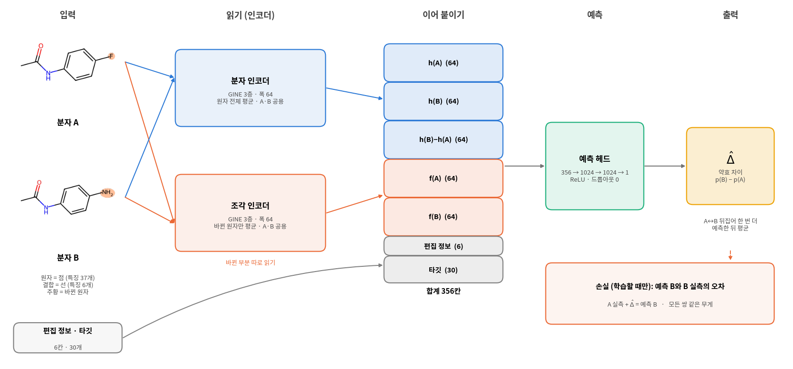

# 쌍 기반 활성 차이 예측 (`ac_pipeline.ipynb`)

구조가 비슷한 두 분자 A, B를 한 번에 넣어 **활성 차이 Δ = p(B) − p(A)** 를 예측한다.
특히 구조는 거의 같은데 활성이 크게 다른 쌍(**activity cliff**, |Δ| ≥ 1 = 10배 이상 차이)을 잘 맞히는 것이 목표다.

## 1. 데이터와 쌍

- **데이터:** MoleculeACE 30개 타깃 (Ki 23개, EC50 7개), 분자 48,714개 (서로 다른 분자 35,633개)
- **분자 나누기:** 학습 64% · 검증 16% · 평가 20% (MoleculeACE 분할 + 학습 분자의 20%를 검증으로)
- **쌍 만들기:** 같은 타깃 안에서 지문 유사도(ECFP4 Tanimoto)가 0.5 이상인 두 분자를 쌍으로 만든다
  - **학습: 유사 쌍 전부** — 유사도 조건만 만족하면 전부 (여러 군데 바뀐 쌍 포함)
  - **평가: 한 군데만 다른 쌍** — 공통 구조(MCS)를 뺀 바뀐 부분이 한 덩어리이고 10원자 이하인 쌍.
    실제로 비교하는 후보 분자는 보통 한 군데만 다르기 때문이다. 유사 쌍 전부 평가도 참고로 둔다
- **평가 원칙:** 모든 쌍에 **실측값을 아는 학습 분자가 하나 이상** 들어가게 한다.
  두 분자 모두 처음 보는 쌍을 Δ만으로 평가하면, 두 분자의 활성을 똑같이 틀려도(실제 3, 0을 13, 10으로) 정답 처리되기 때문이다

## 2. 모델



- 두 분자를 **두 번 읽는다** — 분자 전체(분자 인코더)와 바뀐 부분만(조각 인코더)
- 읽은 결과에 편집 정보(무엇이 몇 군데 바뀌었는지)와 타깃을 붙여 **예측 헤드(1,024 → 1,024 → 1)** 로 Δ를 바로 예측한다
  - 처음에는 헤드가 폭 64 한 층이었는데, 인코더 정보를 다 쓰지 못하는 병목이었다. 지문 기반 쌍 모델(ECFP + MLP)과 같은 크기로 키워 기본으로 쓴다
- 인코더는 두 가지를 비교한다
  - **GINE:** 그래프 신경망(3층, 폭 64), 처음부터 학습
  - **Mole-BERT:** 200만 분자로 미리 학습된 그래프 신경망(5층, 폭 300)을 가져와 미세조정
- **비교 대상:** 항상 0으로 답하기 / **ECFP + SVR**(분자별 예측 후 빼기, MoleculeACE 표준) /
  **ECFP + MLP 쌍**(입력만 지문으로 바꾼 같은 쌍 모델, MoleculeACE의 MLP 설정) /
  같은 인코더로 분자별 예측 후 빼기(쌍 입력이 정말 도움이 되는지 보기 위해)
- 같은 설정을 시드 3개로 학습하고, 세 모델의 예측을 평균한 **시드 앙상블**로 비교한다

## 3. 지금까지 결과

평가 쌍마다 **아는 분자(A) 실측 + 예측 Δ → 예측 B** 를 만들어 **B 실측과 비교한 RMSE** (낮을수록 좋음).
자세한 표와 그림은 [`결과_보고_헤드수정.pdf`](결과_보고_헤드수정.pdf).

**주 결과 — 누수 없음 · 큰 헤드** (한 군데만 다른 평가 쌍 38,711개, 시드 3개 앙상블)

| 모델 | cliff | non-cliff | 전체 |
|---|---|---|---|
| ECFP + SVR (분자별) | 0.914 | **0.455** | **0.591** |
| ECFP + MLP 쌍 | 0.898 | 0.514 | 0.622 |
| GINE 분자별 | 1.380 | 0.529 | 0.805 |
| GINE 쌍 | 0.914 | 0.469 | 0.600 |
| Mole-BERT 분자별 | 1.198 | 0.563 | 0.755 |
| **Mole-BERT 쌍** | **0.889** | 0.471 | 0.592 |

- **Mole-BERT 쌍이 cliff에서 가장 낮고, 전체 오차는 ECFP + SVR과 대등하다** (0.592 vs 0.591). non-cliff는 SVR이 조금 낮다
- **쌍으로 넣는 것이 분자별 예측보다 훨씬 낫다.** 같은 인코더로 cliff 오차가 GINE 34%, Mole-BERT 26% 줄었다
- **같은 쌍 방식에서 그래프 표현은 지문보다 non-cliff·전체가 낮다.** cliff는 ECFP + MLP 쌍과 차이가 시드 흔들림 안이다
- **Δ만 맞히는 것은 아니다.** 학습 분자의 실측값에 Δ̂를 더해 평가 분자의 활성을 추정해도 분자별 예측보다 잘 맞힌다

**누수:** 30개 타깃을 모델 하나로 학습하면, 한 타깃의 평가 분자가 다른 타깃에서는 학습 분자일 수 있다(평가 분자의 약 40%).
두 가지 방식으로 없애고 비교했다 — 누수 분자를 다른 타깃의 학습에서 빼기(우리 방식, 위 표) / 모든 타깃에서 평가로 옮기기(팀원 방식).

| cliff 평가 RMSE (앙상블) | 누수 있음 | 누수 없음 · 팀원 방식 | 누수 없음 · 우리 방식 |
|---|---|---|---|
| ECFP + SVR | 0.928 | 0.977 | 0.914 |
| Mole-BERT 쌍 (작은 헤드) | 0.893 | 1.057 | 0.992 |

누수가 있으면 그래프 쌍 모델이 부풀려진다. 두 방식 모두에서 같은 결론이다. 평가 쌍이 설정마다 달라서 숫자는 같은 열 안에서만 비교한다.

## 4. 개선 시도 결과

목표는 **"차이가 작은 쌍도, 큰 쌍(cliff)도 잘 맞히는 모델"** 이다. 모두 시드 3개로 쟀다.
**차이 없음** = 차이가 시드 흔들림(시드 3개의 최대−최소) 안. 아래 숫자는 평가 쌍 bal = (cliff + non-cliff) / 2 (자세한 표는 노트북 11번 끝 "기록").

| 시도 | 결과 | 처리 |
|---|---|---|
| 예측 헤드 키우기 (폭 64 → 1,024 두 층, 누수 없음) | cliff GINE 1.083 → 0.914, Mole-BERT 0.992 → 0.889 (**좋아짐**) | **반영** — 헤드가 병목이었다 |
| 누수 없애기 (다른 타깃 학습에서 빼기 / 평가로 옮기기) | 그래프 쌍 모델의 cliff가 나빠진다 (위 표) | **반영** — 공정한 평가 |
| 학습은 유사 쌍 전부, 평가는 한 군데만 다른 쌍 | Mole-BERT 0.778 → 0.715 (흔들림 0.004, **좋아짐**), GINE 0.823 → 0.801 (흔들림 0.026, 차이 없음) | **반영** |
| 쌍 판정 고치기 (여러 군데 바뀐 쌍도 바뀐 부분 정보를 살림) | 0.777 → 0.775 (차이 없음) | 반영 — 학습 쌍 대부분이 조각 정보 없이 학습되던 문제라서 |
| 바뀐 부분 따로 읽기 (조각 인코더) | 빼면 0.823 → 0.844 (흔들림 0.060, 차이 없음) | 유지 |
| 편집 정보 빼기 (유사 쌍 전부로 학습, GINE) | 6칸 전부 뺌 0.801 → 0.803, 바뀐 원자 수 칸만 뺌 → 0.805 (차이 없음) | 유지 — "많이 바뀌면 차이가 크다" 단서에 기대지 않음 |
| 차이가 큰 쌍에 가중치 (α) | α = 0보다 나은 경우 없음 | **뺌** |
| cliff 먼저 판단 후 예측 줄이기 (게이트) | 0.823 → 0.875–0.914 (**나빠짐**, cliff 오차 증가) | **뺌** |

### 나중에 할 일

- **노트북 기본값 맞추기:** 노트북은 아직 "누수 있음 · 작은 헤드"가 기본이다(`LEAK_MODE = None`, `HEAD = 'small'`).
  최종 설정(누수 처리 방식)을 정하면 `HEAD = 'big'`과 함께 바꾸고 다시 실행한다 (해당 설정 재학습 필요)
- **편집 정보 빼기 검토:** 빼도 성능이 같아서, 모델을 단순하게 하려면 빼도 된다 (재학습 필요)
- **큰 조각 처리 옵션 빼기:** 바뀐 원자가 많은 쌍의 조각 정보를 비우는 옵션. 효과 없음
- 손실은 모든 쌍을 같은 무게로 보는 보통 MSE로 둔다. MoleculeACE 등 선행연구도 같은 방식이고, 무게를 바꾸는 시도(α)는 효과가 없었다

### 재지 못한 것 (일부러 안 했거나 결정으로 필요 없어진 것)

- 바뀐 부분 따로 읽기 ablation 중 파라미터 수를 맞춘 조건, Mole-BERT로 해 보기 — 빼도 차이가 없어서 더 재지 않았다
- 손실 가중치의 다른 방식(cliff만 무겁게, Huber 손실) — α 자체를 빼서 의미가 없어졌다
- 학습 멈추는 기준을 bal로 바꾸기 — 손실·멈춤 기준은 선행연구처럼 전체 오차로 두기로 했다

## 5. 노트북 구성

| 섹션 | 내용 |
|---|---|
| 1–2 | 데이터 받기, 분자 나누기 |
| 3–4 | 쌍 판정과 쌍 만들기 (학습 쌍과 평가 쌍) |
| 5–6 | 쌍 통계와 예시 |
| 7 | 비교 대상 SVR |
| 8–9 | 그래프 변환, GINE 쌍 모델 학습, 분자별 비교군 |
| 10 | Mole-BERT 쌍 모델 학습, Mole-BERT 분자별 비교군 |
| 11 | 결과 비교 (모든 비교군을 같은 표·그림에), 기준 분자 평가, 누수 점검, 개선 시도 기록 |
| 12 | 결과 정리 |

## 6. 실행

```bash
CUDA_VISIBLE_DEVICES=0 jupyter nbconvert --to notebook --execute --inplace \
    --ExecutePreprocessor.timeout=-1 ac_pipeline.ipynb
```
- 환경: `aienv` (rdkit, torch, torch_geometric, scikit-learn)
- `data/`와 `runs/`는 올리지 않는다. 쌍 목록, 학습된 가중치, 예측값을 여기에 저장해 두고, 있으면 다시 계산하지 않는다
- 처음부터 실행하면 수십 시간, 가중치와 예측값이 있으면 수 분
- Mole-BERT 가중치는 `runs/pretrained/Mole-BERT.pth`에 둔다 ([github.com/junxia97/Mole-BERT](https://github.com/junxia97/Mole-BERT))
- 누수 실험, ECFP + MLP, 예측 헤드 크기, XAI 등 추가 실험과 결과 보고 PDF의 재현 방법은 [`experiments/README.md`](experiments/README.md).
  학습된 가중치·쌍 캐시·예측값 묶음(`capstone_cache_2026-10-12.tar.gz`, 약 590MB)을 받아 풀면 학습 없이 표와 PDF를 다시 만들 수 있다
